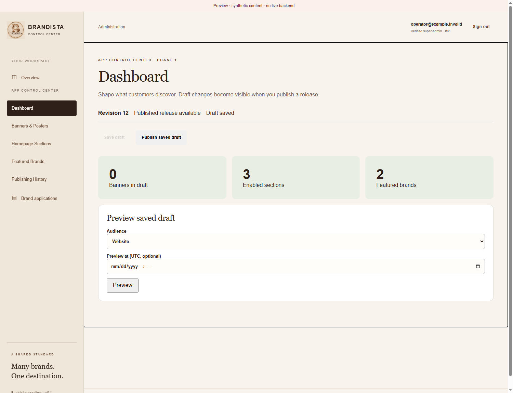
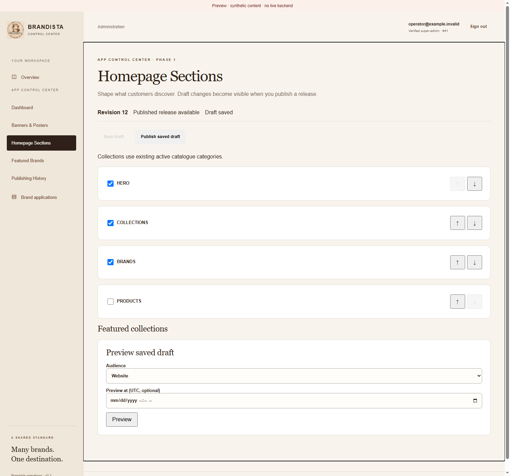

# App Control Center

Super Admin navigation now includes Dashboard, Banners & Posters, Homepage Sections,
Featured Brands and Publishing History. Existing login, grant verification, merchant
workspace and onboarding routes remain unchanged.

The editor saves a complete versioned draft. Save before preview/publication. Preview
supports Website/Mobile and an optional UTC instant. Publishing applies the entire
saved homepage, including enabled banners and their schedules. Clear a banner's
Include checkbox, save, then publish to unpublish it. History is fetched 50 events at
a time with an explicit page; published events support a confirmed rollback.

Collections are active catalogue categories, ordered independently of sections.
Brand and collection selection order is customer display order; arrow buttons reorder
them. Banner images accept PNG/JPEG up to 5 MiB. The backend decodes, strips metadata
and writes them to durable S3-compatible storage. Browser requests use authenticated
multipart upload; no bucket credentials enter the browser.

Dates shown by the banner/preview editors are UTC. Destination options are catalogue
routes shared with the native app; arbitrary external URLs are unsupported. Titles
and descriptions render as text. A stale editor receives a conflict and must reload
before it can overwrite a newer revision.

Deploy the backend with migration V15 and configured durable storage before this
portal. Build with the existing deployed HTTPS `VITE_API_BASE_URL`; no new portal
secrets are needed. No merge, deployment or production content writes are included.

See the backend's `docs/content/APP-CONTROL-CENTER.md` for architecture, API contract,
storage environment settings, deployment order and first-banner publishing steps.

## Review previews

Run `npm ci`, `npm run dev`, then open
`http://127.0.0.1:5174/tests/visual/content.html` for the isolated visual fixture.
Append `?tab=sections`, `?tab=banners`, `?tab=brands` or `?tab=history` to change views.
It uses synthetic records and intercepts all requests; it is excluded from the
production Vite entry point. No real backend is contacted.

## Checks

`npm run build`, `npm run lint`, `npm test -- --maxWorkers=1` and
`npm run format:check`. New tests cover preserving reorder identity, saving an
optimistic version without publishing unsaved edits, and authenticated multipart
headers. Existing authentication, merchant and onboarding tests remain enabled.
